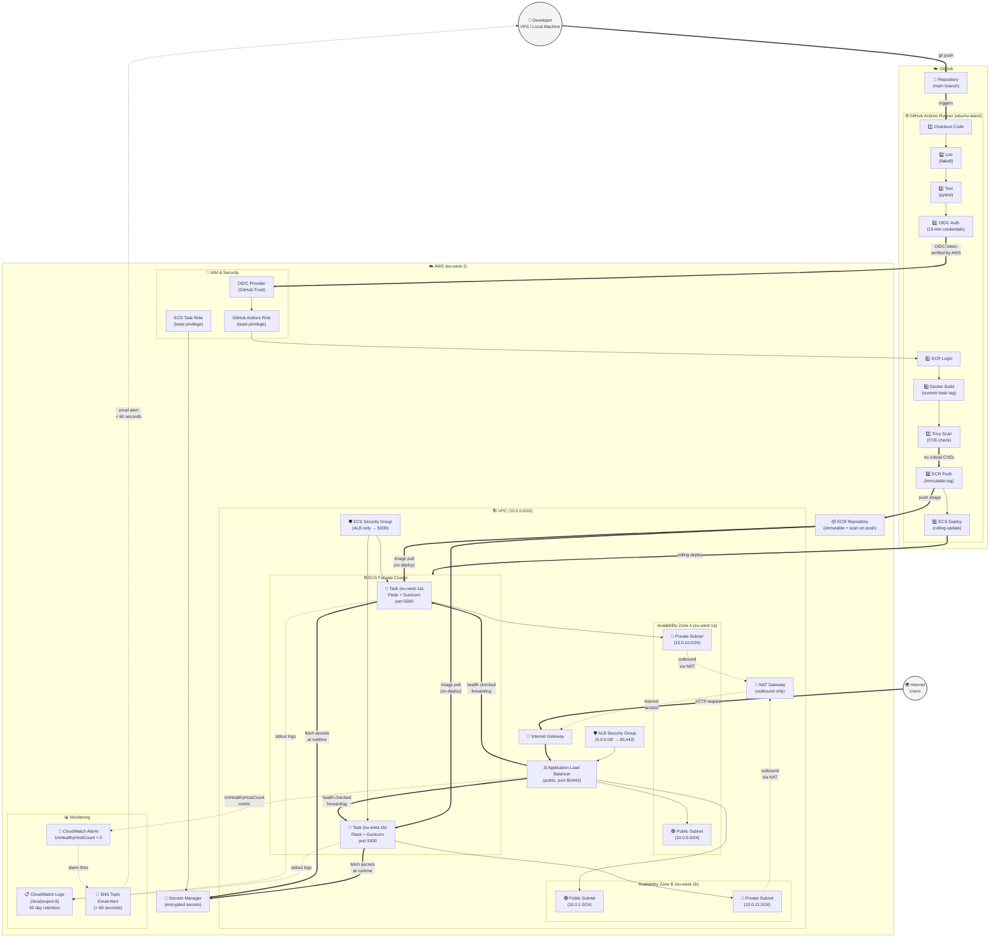

# Project 6 — GitOps CI/CD Pipeline

## 🚀 Project Overview

In this project I designed and implemented a production-grade GitOps CI/CD pipeline on AWS. Every push to the main branch automatically lints, tests, scans, builds, and deploys a containerized Flask application with zero downtime and zero permanent credentials anywhere in the system. The entire AWS infrastructure is provisioned and managed through Terraform as code.

---

## 📋 Architecture Diagram



## 🛠️ Technologies & Core Concepts

| Layer | Technology | Purpose |
|---|---|---|
| Application | Python, Flask, Gunicorn | Lightweight HTTP API server |
| Containerization | Docker | Reproducible, portable builds |
| Container Registry | AWS ECR | Immutable image storage with vulnerability scanning |
| Orchestration | AWS ECS Fargate | Serverless container runtime, no server management |
| Load Balancing | AWS ALB | Traffic distribution, health checks, zero-downtime deploys |
| Networking | AWS VPC, Subnets, NAT Gateway | Isolated, secure multi-AZ network |
| Infrastructure as Code | Terraform | Declarative, reproducible AWS provisioning |
| CI/CD | GitHub Actions | Event-driven automated pipeline |
| Authentication | OIDC (keyless) | Cryptographic identity, zero permanent credentials |
| Secrets | AWS Secrets Manager | Encrypted secret storage, runtime injection |
| Monitoring | CloudWatch Logs + Alarms | Real-time visibility and alerting |
| Security Scanning | Trivy | CVE detection before production |
| Code Quality | flake8, pytest | Lint and automated testing |

---

## 🏗️ Project Structure

```
project-6-gitops/
├── app/
│   ├── app.py                  # Flask application
│   ├── requirements.txt        # Pinned dependencies
│   ├── Dockerfile              # Container build instructions
│   └── test_app.py             # Automated tests (pytest)
├── terraform/
│   ├── main.tf                 # Provider + version constraints
│   ├── variables.tf            # Input variables
│   ├── outputs.tf              # ALB DNS, ECR URL, cluster/service names
│   ├── vpc.tf                  # VPC, subnets, IGW, NAT, route tables, security groups
│   ├── ecr.tf                  # Container registry + lifecycle policy
│   ├── ecs.tf                  # Cluster, task definition, Fargate service
│   ├── alb.tf                  # Load balancer, target group, listener, health checks
│   ├── iam.tf                  # OIDC provider, GitHub Actions role, ECS task role
│   └── cloudwatch.tf           # Log group, CloudWatch alarm, SNS topic + subscription
└── .github/
    └── workflows/
        └── deploy.yml          # Full CI/CD pipeline (8 stages)
```

---

## ⚙️ CI/CD Pipeline Stages

Every push to `main` triggers all 8 stages in order. Any failure stops the pipeline immediately.

**Stage 1 — Checkout.** The runner clones the repository onto the fresh Ubuntu machine. Without this no files exist and everything fails.

**Stage 2 — Lint.** flake8 reads the Python source code and checks for syntax errors and PEP8 style violations. Catches obvious mistakes before wasting time building anything.

**Stage 3 — Test.** pytest runs automated tests against both Flask endpoints verifying correct status codes and response bodies. Catches application logic errors that lint cannot detect.

**Stage 4 — OIDC Authentication.** GitHub signs a JWT token with its private key. AWS verifies the signature using GitHub's public key fetched from the well-known OIDC endpoint. AWS checks two conditions: the token audience must be `sts.amazonaws.com` and the subject must match this specific repository using the new July 2026 numeric ID format. If both pass AWS issues temporary credentials lasting 15 minutes. No permanent keys exist anywhere.

**Stage 5 — ECR Login.** The temporary AWS credentials are exchanged for a Docker login token. Docker uses this token to authenticate pushes to ECR.

**Stage 6 — Docker Build.** Docker builds the image tagging it with the Git commit hash. The tag permanently and uniquely identifies the exact code version that produced this image.

**Stage 7 — Trivy Scan.** Trivy pulls a CVE database and scans every layer of the image. If any critical vulnerability with an available fix is found the pipeline stops. The image is never pushed to production.

**Stage 8 — ECR Push + ECS Deploy.** The approved image is pushed layer by layer to ECR with an immutable tag. The current ECS task definition is fetched, the image URL is updated, a new revision is registered, and the ECS service performs a rolling deployment. New container starts, passes health checks, old container stops. Users experience zero downtime. The pipeline waits and watches until ECS confirms stability.

---

## 🔐 Security Architecture

### Keyless Authentication (OIDC)

This project uses no permanent AWS credentials anywhere. No access keys stored in GitHub Secrets.

When the pipeline runs GitHub issues a cryptographically signed JWT token. The token contains the repository owner ID, repository ID, branch, and commit SHA. AWS verifies the signature against GitHub's published public key. AWS checks the trust policy conditions on the IAM role. Only tokens from this specific repository are accepted. AWS issues temporary credentials lasting 15 minutes. After expiry the credentials are permanently useless even if intercepted.

### Least Privilege IAM

The GitHub Actions role has exactly six permissions. ECR authentication, ECR push operations on this specific repository only, ECS task definition registration, ECS service update on this specific service only, IAM role passing for the ECS task role only, and ECS task definition description. Nothing else. Compromise of these credentials cannot affect any other resource in the AWS account.

The ECS task role has two permission sets. The AWS-managed execution policy allowing ECR image pulls and CloudWatch log writes. A custom inline policy allowing Secrets Manager reads on this specific secret only.

### Defense in Depth Networking

The ALB security group allows inbound traffic from the internet on ports 80 and 443 only. The ECS security group allows inbound traffic only from the ALB security group on port 5000. No internet traffic can reach containers directly. Even knowing a container's private IP address, all connection attempts are blocked at the network level.

---

## 📊 Monitoring & Observability

Every line your container prints to stdout is automatically captured by the `awslogs` driver and shipped to CloudWatch Logs in the `/ecs/project-6` log group. Logs are retained for 30 days and automatically deleted after that to control costs. This is the only real-time visibility into container behavior since Fargate provides no SSH access.

The ALB performs health checks against the `/health` endpoint every 30 seconds. The `UnHealthyHostCount` metric is published to CloudWatch every 60 seconds. A CloudWatch Alarm monitors this metric continuously. The moment any container fails health checks and the count exceeds zero the alarm fires, calls the SNS topic, and delivers an email alert within 60 seconds. Problems are detected and reported before users notice them.

---

## 🧠 Key Engineering Decisions

**Why ECS Fargate over EC2?** Fargate eliminates server management entirely. No OS patching, no capacity planning, no SSH access to maintain. You define what to run and AWS manages where it runs. The tradeoff is less control over the underlying host, which is acceptable for a containerized stateless application.

**Why OIDC over stored access keys?** Permanent credentials stored in GitHub represent an unbounded security risk. Any accidental repository exposure or GitHub breach permanently compromises the AWS account. OIDC credentials expire in 15 minutes and are cryptographically bound to a specific repository. Credential compromise cannot be sustained.

**Why immutable ECR image tags?** Mutable tags allow overwriting. A broken image could overwrite `latest` and eliminate the rollback path. Immutable tags guarantee every tag permanently identifies exactly one image. Rollback always works because the target image cannot change.

**Why one NAT Gateway?** A fully highly available architecture uses one NAT Gateway per availability zone. This project uses one deliberately to minimize costs while demonstrating the architecture correctly. If `eu-west-1a` goes down containers in `eu-west-1b` lose outbound internet access. This tradeoff is consciously documented. In a production system handling revenue the additional NAT Gateway cost is justified.

**Why split Terraform into nine files?** Terraform reads all `.tf` files as one configuration. Splitting by concern makes the code navigable and maintainable. Each file has one responsibility. A networking change goes to `vpc.tf`. A security change goes to `iam.tf`. A monitoring change goes to `cloudwatch.tf`. No file is responsible for more than its named concern.

---

## 🐛 Real Production Issues Debugged

**GitHub OIDC sub claim format change (July 2026).** GitHub changed the `sub` claim format for repositories created after July 15, 2026 to include numeric owner and repository IDs alongside human-readable names. The old format `repo:owner/repo:*` no longer matched. Diagnosed by decoding the actual JWT token claims in a debug pipeline step. Fixed by updating the IAM trust policy condition to use the new format `repo:owner@ownerID/repo@repoID:*`.

**Trivy blocking unfixable vulnerabilities.** Trivy found four critical CVEs in the `perl-base` package inside the Debian base image. All four had empty Fixed Version columns meaning no patch exists. Blocking deployment over vulnerabilities with no available fix is counterproductive. Fixed by adding `--ignore-unfixed` to the Trivy command so the pipeline only fails on vulnerabilities that actually have a fix available.

**Terraform state loss.** The `terraform.tfstate` file and the `.terraform` provider directory were accidentally committed to Git. The provider binary is 674MB which exceeds GitHub's 100MB file size limit. Resolved by rewriting Git history with `git filter-branch` to remove the large file, creating a proper `.gitignore` covering all Terraform artifacts, and force pushing the clean history.

---

## 🚀 Deploying This Project

### Prerequisites

- AWS account with programmatic access
- Terraform >= 1.5.0
- AWS CLI configured
- Docker
- A variable for the alert email: `terraform apply -var="alert_email=you@example.com"`

### Step 1 — Provision Infrastructure

```bash
cd terraform
terraform init
terraform plan
terraform apply
```

### Step 2 — Configure GitHub Repository

Add a repository secret named `ROLE_TO_ASSUME` containing the GitHub Actions role ARN from the Terraform outputs. Update the `sub` condition in `iam.tf` with your repository's numeric owner and repository IDs.

### Step 3 — Trigger First Deployment

```bash
git push origin main
```

Monitor the pipeline in the GitHub Actions tab. After completion test the live endpoints using the ALB DNS name from Terraform outputs.

### Step 4 — Destroy When Done

```bash
cd terraform
terraform destroy
```

---

## Author

Amr — Cloud Engineer  
